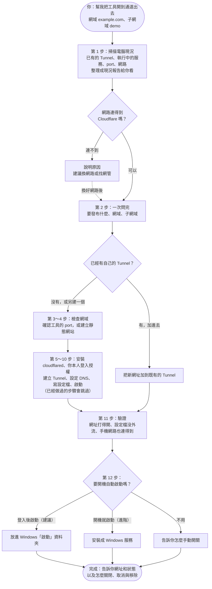

# Cloudflare Tunnel 發布助手（Claude Skill）

用中文、用對話的方式，讓 AI 幫你把電腦上的網站或工具，透過 Cloudflare Tunnel 開到自己的網域，例如 `https://demo.example.com`。不需要固定 IP，也不用在路由器上開 port。

## 它會幫你做什麼

- **先掃描你的電腦**：有沒有已經存在的 Tunnel、哪些程式正在跑、網路能不能連到 Cloudflare，整理成一份簡短的現況報告。
- **問你要發布什麼**：已經在跑的工具、靜態網頁，或先用範例頁測試；以及網域和子網域。
- **一步一步完成設定**：安裝 cloudflared、建立 Tunnel、設定 DNS、啟動，並驗證網址真的打得開。
- **問你要不要開機自動打開通道**：可以選登入後自動啟動，或安裝成 Windows 服務。
- **教你關閉、移除和排錯**：包括 502、Error 1033 等常見錯誤。

## 流程圖



## 事前準備

- 一個 Cloudflare 帳號，以及**已經託管在 Cloudflare** 的網域（網域的 NS 指向 Cloudflare）。
- Windows 11。macOS 和 Linux 有對應說明，但還沒實測過。
- 要發布的東西：已經在跑的工具（例如 `http://localhost:3000`）、靜態網頁，或先用範例頁測試。

## 安裝

### Claude Code（建議：AI 可以直接幫你操作電腦）

Windows PowerShell：

```powershell
git clone https://github.com/luckmoiJay/cloudflare-tunnel-publish.git
New-Item -ItemType Directory -Force "$env:USERPROFILE\.claude\skills"
Copy-Item -Recurse cloudflare-tunnel-publish\skills\cloudflare-tunnel-publish "$env:USERPROFILE\.claude\skills\"
```

macOS 或 Linux：

```bash
git clone https://github.com/luckmoiJay/cloudflare-tunnel-publish.git
mkdir -p ~/.claude/skills
cp -r cloudflare-tunnel-publish/skills/cloudflare-tunnel-publish ~/.claude/skills/
```

裝好後重新開啟 Claude Code。

### Claude 網頁版或桌面 App 的對話

1. 下載 [`cloudflare-tunnel-publish.skill`](cloudflare-tunnel-publish.skill)。
2. 到 Claude 的設定裡找到 Skills（技能），上傳這個檔案。

這種模式下 AI 不能直接操作你的電腦，會一步一步給你指令，請你複製到 PowerShell 執行，再把結果貼回去。

## 怎麼用

裝好之後，直接用中文跟 AI 說，例如：

> 幫我把電腦上 3000 port 的工具用 Cloudflare Tunnel 開出去，網域是 example.com，子網域用 demo

> 幫我開通道，我想把這個資料夾的網頁發布到 demo.example.com

接下來 AI 會：

1. 先掃描你的電腦，給你一份現況報告。
2. 跟你確認要發布的東西和網址。
3. 一步一步完成設定。需要登入 Cloudflare 時，會請你自己在瀏覽器按授權。
4. 驗證網址真的打得開。
5. 問你要不要開機自動啟動。

`example.com` 只是示意，請換成你自己的網域。

## 注意事項

- 網站其實還是跑在你的電腦上：關機、睡眠或斷線時，網站就會連不上。適合測試、Demo 和短期展示，不適合正式網站。
- AI 不會、也不需要你的 Cloudflare 密碼或任何金鑰；登入授權由你自己在瀏覽器完成。
- 發布出去的內容任何人都看得到，不要放密碼、個資或未公開的資料。
- 在公司或學校的電腦或網路上使用前，請先確認符合網管規定。

## 檔案結構

```text
skills/cloudflare-tunnel-publish/SKILL.md                  Skill 本體
skills/cloudflare-tunnel-publish/references/autostart.md   自動啟動的詳細做法
cloudflare-tunnel-publish.skill                            打包好的檔案，給 Claude 網頁版或桌面 App 上傳
```

## 授權

[MIT License](LICENSE)：可以自由使用、修改和分享，只要保留原本的版權聲明。
